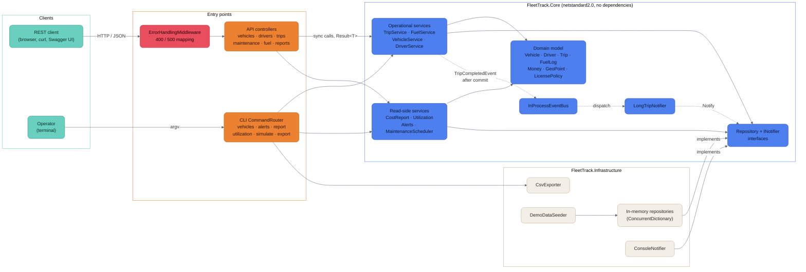
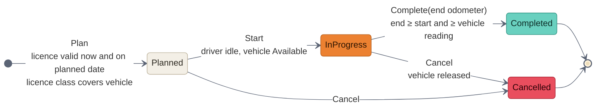
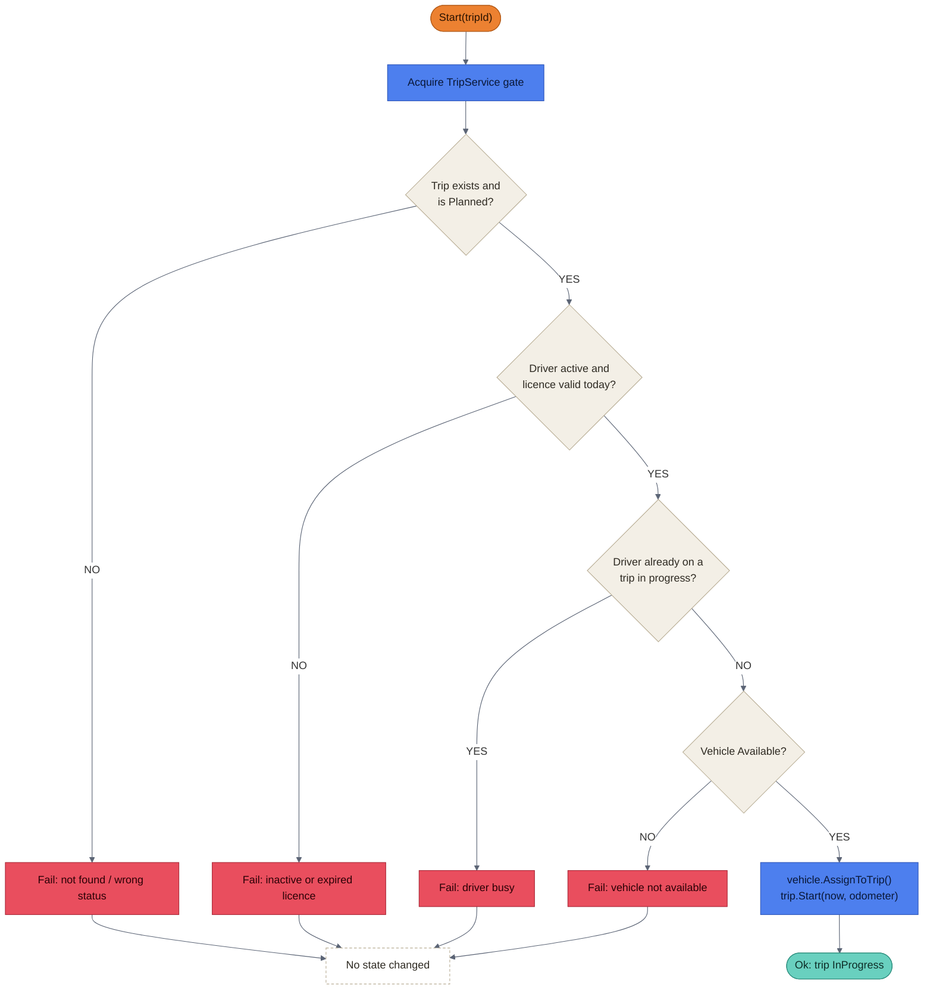
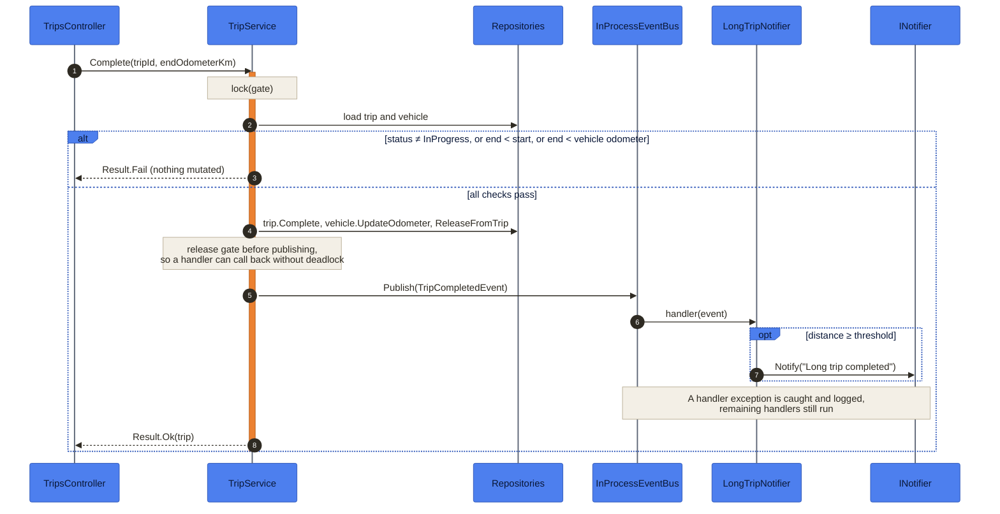

# Architecture

FleetTrack is a single-process application with a dependency-free core. The API and the
CLI are two thin front-ends over the same services; persistence is in memory.

## Component overview

| **Colour** | **Layer** | **Meaning** |
|---|---|---|
| Teal | Clients | Callers outside the process |
| Orange | Entry points | Translate requests into service calls |
| Royal blue | Core | Business rules; no I/O, no third-party packages |
| Cream | Infrastructure | Replaceable implementations of Core interfaces |
| Coral | Error boundary | Where exceptions become HTTP status codes |

Solid arrows are synchronous calls; dashed arrows are the in-process event flow.

## Trip lifecycle

Completed and Cancelled are terminal. A vehicle is `InUse` exactly while one of its trips is
`InProgress`; servicing or retiring it in that state is rejected.

## Starting a trip

Every check runs inside `TripService`'s gate before anything is mutated, so a failed start
leaves the trip, the vehicle and the driver exactly as they were.

## Completing a trip and publishing the event

## Domain rules

| **Rule** | **Enforced in** | **Why** |
|---|---|---|
| A vehicle is on at most one trip at a time | `Vehicle.AssignToTrip` (atomic) | Physical constraint |
| A driver is on at most one trip at a time | `TripService.Start` | A planned overlap may be resolved; a driven one cannot |
| Licence must be valid now, on the planned date and at start | `TripService.Plan`, `TripService.Start` | Licences expire between booking and departure |
| Licence class must cover the vehicle category | `LicensePolicy`, `TripService.Plan` | Simplified EU B / C / CE / D model |
| Odometers never move backwards | `Vehicle.UpdateOdometer`, `TripService.Complete` | Catches mistyped readings |
| A vehicle on a trip cannot be serviced or retired | `Vehicle.CompleteMaintenance`, `Vehicle.Retire` | Servicing would release it for a second trip |
| A fill-up must fit between its neighbours in time | `FuelService.RecordFill` | Receipts are entered late and out of order |

## Concurrency

The API registers services and repositories as singletons, and the in-memory repositories
hand out live entity instances. Every operation that checks state and then changes it
holds a lock:

| **Scope** | **Lock** | **Protects** |
|---|---|---|
| One vehicle | `Vehicle._sync` | Status transitions and odometer updates |
| Trip lifecycle | `TripService._gate` | Cross-aggregate checks (driver idle, vehicle free) |
| Registration | `VehicleService` / `DriverService` gates | Plate and licence-number uniqueness |
| Fuel log | `FuelService._gate` | Neighbour validation and odometer advance |

These locks are correct only within a single process. A database-backed deployment would
replace them with transactions plus unique constraints or optimistic concurrency.

## Error handling

Expected failures are returned as `Result` / `Result<T>`. `DomainException` marks a broken
invariant; `ErrorHandlingMiddleware` maps it, and `ArgumentException`, to HTTP 400, logs
anything else as a 500, and rethrows if the response has already started.

## Known limitations

| **Area** | **Limitation** | **Possible next step** |
|---|---|---|
| Persistence | In memory; data is lost on restart | EF Core repositories behind the same interfaces |
| Maintenance | Time-based interval starts only after the first recorded service | Track a commissioning date per vehicle |
| Cost per km | Includes the first fill-up's cost, whose fuel was burnt before the period | Pro-rate by the full-tank method, as fuel efficiency already does |
| Trip distance | Odometer-based only | No plausibility check against the great-circle distance, since ferries and trains move vehicles without odometer progress |
